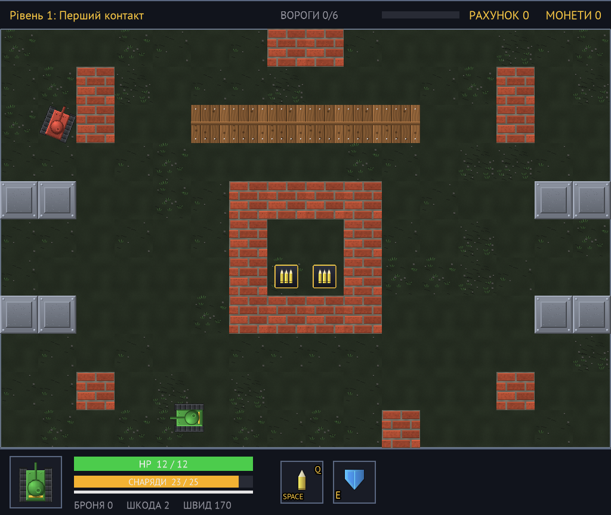
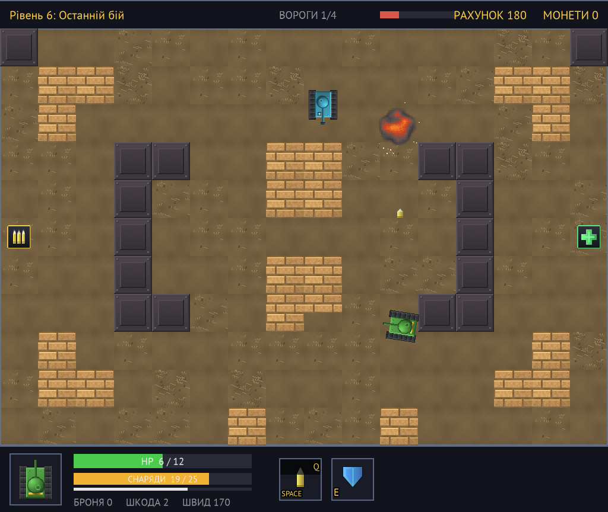
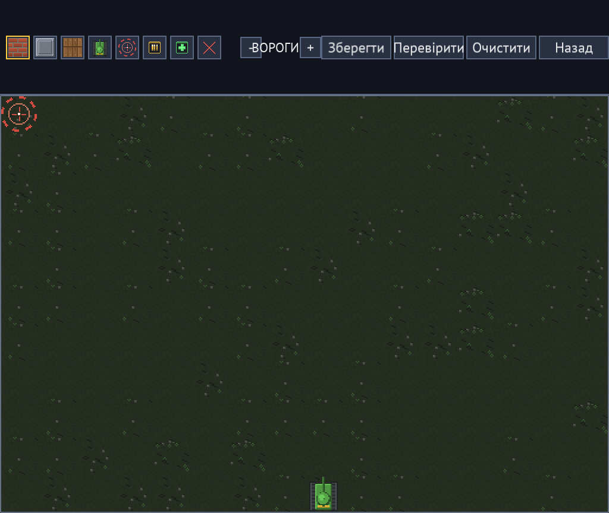
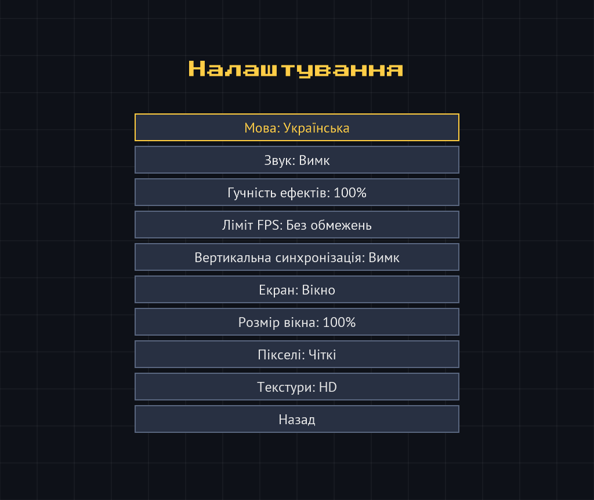

# TanksClone

A roguelike take on the classic top-down tank shooter, written in C++ on Cocos2d-x.
The player fights through a campaign of levels (maps of any size, with a camera that follows the tank),
destroys waves of enemy tanks, collects coins and buys upgrades between levels.



| Boss fight | Editor | Settings |
|---|---|---|
|  |  |  |

More screenshots and short clips per version: [`docs/history/`](docs/history/).

## Features

- Campaign of levels loaded from JSON; large scrolling maps with a player start point
- Enemy waves from spawners (pools, limits); enemies built from stats, abilities and buffs
- Coins, shop and upgrades, saved profile
- Two weapons (cannon and machine gun), abilities (shield), destructible brick walls
- Localization (English, Ukrainian), MOBA-style HUD, level editor
- Unit tests, menu autotests and a bot that plays levels (`--test`)

## Architecture

The target is MVVM with an engine-agnostic core: the Model is plain C++ (entities, stats, buffs, AI,
spawners, fixed-step deterministic simulation), the View is a swappable adapter (Cocos now; WinAPI,
Unreal or console later) behind ports for rendering, input, audio, storage and configs.
All game data lives in JSON: a new enemy is a new file. The current code still mixes logic with Cocos;
the migration plan is in [`ROADMAP.md`](ROADMAP.md). Rules: [`.claude/rules/`](.claude/rules/).

## Requirements

- Windows 10/11, Visual Studio 2022 (toolset v143, Windows SDK 10.0.22621.0, "Desktop development with C++")
- **Cocos2d-x 3.17** (exactly `cocos2d-x-3.17`, not 3.17.1/3.17.2/4.x). The engine is not stored in this repository.
- Python 3 (standard library only) for the asset tools; ffmpeg optional, for clips

## Setup

1. Clone the repository.
2. Download Cocos2d-x 3.17 (`cocos2d-x-3.17.zip` from the
   [cocos2d-x releases](https://github.com/cocos2d/cocos2d-x/releases/tag/cocos2d-x-3.17)) and unpack it so that
   the engine sits in `cocos2d/` in the repository root (`cocos2d/cocos/cocos2d.cpp` must exist).
3. Fetch the engine's prebuilt third-party libraries:
   ```
   cd cocos2d
   python download-deps.py
   ```
   (`download-deps.py` needs Python 2.7, as in the engine itself.)
4. Turn off 3D physics and Box2D in the engine (no Windows libraries are shipped for them): in
   `cocos2d/cocos/2d/cocos2d_headers.props` set `CC_USE_3D_PHYSICS=0` (and keep Box2D/Bullet off).
5. Open `proj.win32/TanksClone.sln` in Visual Studio, or build from the command line (below).

## Build and run

```
MSBuild proj.win32\TanksClone.sln /p:Configuration=Debug /p:Platform=Win32 /p:PlatformToolset=v143 /p:WindowsTargetPlatformVersion=10.0.22621.0 /m
proj.win32\Debug.win32\TanksClone.exe --test
```

| | Debug | Test | Release |
|---|---|---|---|
| optimizations, engine | no, Debug | yes, Release | yes, Release |
| `--test` (unit tests, bot on levels, menu tests) | yes | yes | no |
| engine stats (FPS, draw calls) | F3 | F3 | no |
| `.pdb` symbols in dist | yes | yes | no |

`Test` is Release optimizations plus debug tools (`TANKS_DEBUG_TOOLS`) for a fast `--test` run and performance checks.
After each build `tools/make_dist.ps1` copies the exe, engine DLLs and `Resources/` into `dist/<Configuration>/`.
Player archive: `tools/make_release.ps1 -Build` produces `dist/TanksClone-<version>-win32.zip`.

`--test` writes its profile and custom level to `%TEMP%\TanksCloneTests`; the real profile is untouched.
`--showcase <folder>` (Debug, Test) saves screenshots of all screens and levels plus frames of a 5-second bot clip;
`python tools/make_gif.py <folder>/clip clip.gif` turns them into a GIF.

## Controls

WASD / arrows: move. Space: fire. Q / Tab: cannon / machine gun. E: ability (shield). Esc: pause. F3: engine stats (Debug, Test).

## Project layout

```
Classes/        game code (core, game, services, scenes, ui, tests)
Resources/      everything the game reads at runtime (goes into the build)
  configs/      JSON: objects, enemies/, levels/, strings/, resources.json
  textures/     atlases .plist + .png, generated from art/ (do not edit by hand); textures_hd/ for HD
  sounds/       .wav
  fonts/        fonts (OFL: Press Start 2P, PT Sans) and their licenses
art/, art_hd/   source frames for the atlases (not shipped)
tools/          Python/PowerShell scripts: art, atlases, icons, sounds, dist, release, clips
docs/history/   screenshots and clips per version
proj.win32/     Visual Studio project (maintained)
proj.android, proj.ios_mac, proj.linux   Cocos template projects, not maintained
cocos2d/        engine (not in git, see Setup)
dist/           built copies of the game (not in git)
```

## Assets

- New frame: PNG in `art/<atlas>/`, then `python tools/pack_atlases.py` (check with `--check`).
  Frame names are unique across all atlases; tileset frames are prefixed (`desert/wall_brick`).
- New enemy: `configs/enemies/<Id>.json` with `"atlas": "textures/enemies/<Id>.plist"` and frames in `art/enemies/<Id>/`.
- New tileset: frames in `art/tilesets/<name>/`, entry in `configs/resources.json`.
- Current art and sounds are generated placeholders (`tools/gen_placeholder_art.py`, `gen_placeholder_sounds.py`, `gen_app_icons.py`).
